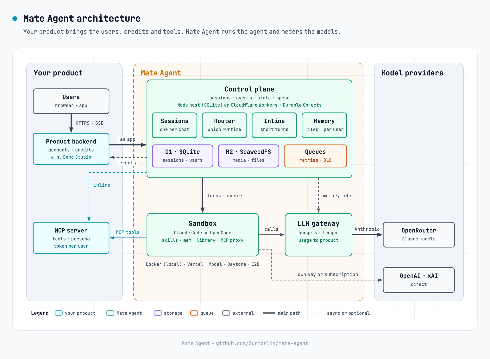

# Mate Agent

A general-purpose agent runtime. A client opens a session; the engine keeps the session's messages,
events and state, and runs the agent in a sandbox (Claude Code with skills and memory, or OpenCode
for OpenAI, xAI and the other non-Anthropic models) or, for short turns, inline. It serves one
product, which brings its own accounts, persona, tools (an MCP server) and credits; a new product
forks the engine. `packages/demo-app` is the reference product. Built on
[Open-Inspect](https://github.com/ColeMurray/background-agents)
([docs/UPSTREAM.md](docs/UPSTREAM.md)).

<picture>
  <source media="(prefers-color-scheme: dark)" srcset="docs/images/architecture-dark.png">
  
</picture>

<sub>Source: [docs/images/architecture.html](docs/images/architecture.html). Edit it, then re-render
both PNGs.</sub>

## Repository map

| Path                            | What is in it                                                                                      |
| ------------------------------- | -------------------------------------------------------------------------------------------------- |
| `packages/control-plane`        | The engine                                                                                         |
| `packages/shared`               | Types and utilities shared by the workspaces                                                       |
| `packages/sandbox-runtime`      | Python that runs inside a sandbox                                                                  |
| `packages/sandbox-images`       | The sandbox image build; `vercel-infra` and the other `*-infra` are provider tooling               |
| `packages/demo-app`             | Demo Studio: the reference product (accounts, credits, MCP tools; an app shell on a design system) |
| `packages/gateway`              | The LLM gateway: a Cloudflare Worker (what dev runs) and a Node host (SQLite) for the local stack  |
| `packages/docker-dataplane`     | The local Docker data plane                                                                        |
| `skills/`                       | `builtin` (baked into the image), `remotion-starter`, `tests`                                      |
| `deploy/cloudflare`             | Worker configs and the deploy and smoke scripts for the dev environment                            |
| `deploy/d1/migrations`          | D1 migrations, additive only                                                                       |
| `deploy/compose`, `deploy/edge` | The local Docker stacks, their env examples, the edge proxy                                        |
| `scripts/`                      | `verify.mjs`, lint checks, git hooks, the agent guard, the local stack and benchmarks              |
| `docs/`                         | Documentation; `docs/USER_MEMORY.md` is the memory design                                          |

Everything at the root is there because a tool reads it from there (`.github`, `.husky`, `.claude`,
`.nvmrc`, `package.json`, the lint configs); `scripts/check-layout.mjs` keeps it that way.

## Getting started

Node 24 is required (`.nvmrc`; other majors give false failures). On macOS with Homebrew:

```bash
export PATH=/opt/homebrew/opt/node@24/bin:$PATH
npm ci
npm run build -w @open-inspect/shared      # the other workspaces import it built
npm run verify -- --level static           # about a minute: layout, lint, format, contracts
npm run verify                             # everything CI runs, about ten minutes
```

Run the engine on your machine with Docker (copy `deploy/compose/engine.env.example` to
`.env.engine` and fill in the secrets first):

```bash
docker compose -p agent-engine --env-file .env.engine \
  -f deploy/compose/docker-compose.engine.yml up -d --build --wait
```

## Run it on this machine

No cloud: the control plane's Node host, a local Docker data plane that stands in for the sandbox
provider, and SeaweedFS as the object store. Docker Desktop must be running.

```bash
scripts/local/env.sh            # once: writes .env.local (ignored) with fresh local secrets
# put your own OPENROUTER_API_KEY into .env.local
docker build -f packages/docker-dataplane/sandbox.Dockerfile -t agent-engine-sandbox:local \
  packages/sandbox-runtime      # the slim, native sandbox image
scripts/local/object-store.sh   # SeaweedFS on 127.0.0.1:9017
scripts/local/gateway.sh        # the LLM gateway on 127.0.0.1:8795 (foreground)
scripts/local/dataplane.sh      # sandboxes as containers, on 127.0.0.1:9910 (foreground)
scripts/local/control-plane.sh  # the engine on 127.0.0.1:8797 (foreground)
scripts/local/agent.sh "Write hello.txt and read it back"
scripts/local/demo-app.sh       # optional: Demo Studio on 127.0.0.1:9320 (packages/demo-app/README.md)
```

Or all of it in the background, then check it works end to end with a real model (a few cents, about
five minutes; `--no-model` runs only what costs nothing; see
[docs/LOCAL_E2E.md](docs/LOCAL_E2E.md)). The browser check needs Chromium once:
`npx playwright-core install chromium`.

```bash
scripts/local/stack.sh up       # object store, gateway, data plane, control plane, Demo Studio
npm run e2e:local               # the API: accounts, isolation, MCP tools, credits, inline, sandbox, preview
npm run e2e:ui                  # the browser: routing, themes, phone and desktop, preview (needs a browser, below)
scripts/local/stack.sh down
```

If another stack already holds a port, set `ENGINE_PORT`, `GATEWAY_PORT`, `DATAPLANE_PORT`,
`LOCAL_OBJECT_STORE_PORT` or `DEMO_PORT` when you run `scripts/local/env.sh`.

The slim image is enough for most work. To run the full image (the one cloud providers build:
Chromium, code-server, the pinned toolchain) on Apple silicon, turn on Docker Desktop's
Virtualization framework and Rosetta (Settings → General), then:

```bash
python3 packages/sandbox-images/cli.py pack --provider daytona --output .local/image-context
docker build --platform linux/amd64 -f packages/sandbox-images/Dockerfile \
  --build-arg BASE_IMAGE=python:3.12-slim-bookworm -t agent-engine-sandbox:full \
  .local/image-context/<the directory pack printed>
DATAPLANE_IMAGE=agent-engine-sandbox:full DATAPLANE_PLATFORM=linux/amd64 scripts/local/dataplane.sh
```

Under QEMU (Rosetta off) the build fails: `uv python install` segfaults.

## Environments, branches and versions

There is no cloud environment: everything runs on this machine (see AGENTS.md, "Red lines"). `dev`
is the trunk; feature branches go into it. `main` holds the released versions only: it moves
forward, to a commit that carries a release tag, and nothing else is merged into it
([docs/RELEASING.md](docs/RELEASING.md)). GitHub's default branch is `main`, so someone who clones
the repository sees the latest release; develop on `dev` and open pull requests into `dev`. The
repository is not a GitHub fork of Open-Inspect, and takes fixes from it by hand
([docs/UPSTREAM.md](docs/UPSTREAM.md)).

The repository has one version, now **0.2.0**: the root `package.json`, every workspace and
`package-lock.json` carry the same number, `CHANGELOG.md` has a section for it, and the git tag
`v0.2.0` marks the commit. `npm run verify` checks that they agree. How to cut one:
[docs/RELEASING.md](docs/RELEASING.md).

## Working in this repository

[AGENTS.md](AGENTS.md) is the one page to read first, for people and agents alike: the red lines (no
pushes without being asked, no `git stash`, no changes to cloud environments without asking), the
layout, the checks. They are enforced by git hooks (`.husky`) and, in Claude Code sessions, by a
hook (`scripts/agent-guard`).

More: [CHANGELOG.md](CHANGELOG.md) (release notes), [docs/RELEASING.md](docs/RELEASING.md) (cutting
a version), [docs/LOCAL_E2E.md](docs/LOCAL_E2E.md) (the end-to-end check),
[docs/HOW_IT_WORKS.md](docs/HOW_IT_WORKS.md) (session lifecycle, from upstream),
[packages/control-plane/README.md](packages/control-plane/README.md) (API and D1 schema),
[docs/USER_MEMORY.md](docs/USER_MEMORY.md) (user memory),
[packages/demo-app/DESIGN.md](packages/demo-app/DESIGN.md) (Demo Studio's design system).

## Contributing

Pull requests go into `dev`; see [.github/CONTRIBUTING.md](.github/CONTRIBUTING.md). Report a
security problem privately, as [.github/SECURITY.md](.github/SECURITY.md) says.

## License

MIT, see [LICENSE](LICENSE). Mate Agent is built on Open-Inspect, also MIT. The HyperFrames skills
in `skills/builtin` are Apache-2.0 ([NOTICE](skills/builtin/hyperframes/NOTICE.md)).
